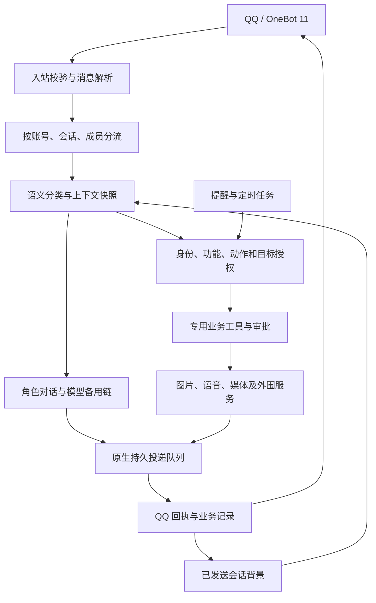

# elysia_bot-openclaw

基于 **OpenClaw + OneBot 11** 的 QQ 角色机器人定制项目。以爱莉希雅（Elysia）为主要交互角色，支持多角色对话、图片与语音、社交媒体搜索回传、QQ 空间互动、Bilibili 订阅，以及能延续聊天上下文的定时任务。

本项目把聊天编排、业务工具、权限、审批和消息投递分开管理：模型负责理解需求与生成回复，程序负责校验身份、约束操作范围并确认实际发送结果。

> **仓库定位**：这是经过脱敏的定制源码与集成归档，不是完整的 OpenClaw 发行版，也不是开箱即用的 Docker 整合包。真实运行配置、账号登录态、角色私有记忆、参考图片、TTS 权重及部分外围服务不随仓库提供。`config/examples/` 是结构示例，不能直接复制后启动全部功能。

## 目录

- [主要功能](#主要功能)
- [架构与消息流程](#架构与消息流程)
- [身份、权限与会话隔离](#身份权限与会话隔离)
- [模型与上下文](#模型与上下文)
- [仓库结构](#仓库结构)
- [运行环境与依赖](#运行环境与依赖)
- [部署与配置](#部署与配置)
- [开发、检查与测试](#开发检查与测试)
- [源码归档与安全提交](#源码归档与安全提交)
- [已知限制](#已知限制)
- [详细文档](#详细文档)
- [上游项目与许可](#上游项目与许可)

## 主要功能

### 角色对话与消息理解

- 支持私聊、群聊艾特和多机器人账号，可按群配置允许交互的角色及功能。
- 入站模型统一判断搜索、图片、语音、额度及提醒等意图，再由固定业务入口执行；分类结果本身不授予权限。
- 解析引用消息与 QQ 合并聊天记录，在可读取的范围内补充原始文本、作者顺序和图片上下文。无法读取时标记原因，不把缺失内容当作已知事实。
- 同一群内不同成员分别处理聊天和工具流；同一成员同一会话的操作保持顺序，避免被另一人的长任务阻塞或串用工具结果。
- 区分普通聊天、进度消息、业务结果和最终投递回执；长任务可先报告已完成部分，再在更长的执行预算内继续。
- 对访客使用昵称或中性称谓，限制角色私有资料和内部信息进入对外回复。

### 图片生成、参考图与质量复核

- 支持文本生图、图片编辑和角色参考图生成，包含提示词优化、参考图编排、错误诊断及有限重试。
- 参考图用于人物身份和外观参考；动作、表情和场景需与当次活动描述对应。
- 图片复核重点检查身体畸形、多余肢体等严重错误；不达标时重试。每日空间配图链路可在最多三次成功生成的候选仍不达标时选择最高分结果。
- 生成失败、质量不达标和发送失败分别记录，避免把“已生成文件”误报为“已经发到 QQ”。
- 上游图片能力、参考素材、评分阈值与超时取决于实际部署配置，仓库不附带素材和在线凭据。

相关实现：[AGY 技能](workspace/skills/agy-proxy/SKILL.md)、[图片诊断](onebot-onebot-custom/src/src/image-diagnostics.js)。

### 爱莉语音回复

- 对接本地 GPT-SoVITS 服务，区分“用语音回答问题”和“按原文朗读”两种意图。
- 当前专用 TTS 功能限爱莉角色使用；明确语音回复的合成文本最多 **200 个 Unicode 字符**，超限时解释原因并发送完整文字。
- 未明确要求或拒绝语音时，可按 **30% 概率**追加不超过 **40 字**的简短语音，追加内容与正文共同生成。
- 访客的合成文本经过角色与内容审查；TTS 不开放任意脚本执行或跨会话发送权限。
- 权重、音频参考和本地服务需单独准备，不包含在源码仓库中。

相关实现：[TTS 技能](skills/elysia-tts/SKILL.md)、[语音业务模块](onebot-onebot-custom/src/src/features/speech.js)。

### 搜索与社交媒体工作流

| 来源 | 主要能力 | 交付与边界 |
| --- | --- | --- |
| Gemini 联网检索 | 由入站语义分类决定是否核查可能过时的知识及现实问题 | 使用对应模型接口的原生检索适配；不将其等同于任意本地命令 |
| 小红书 | 关键词搜索、帖子详情、公开博主资料、图片与视频下载、媒体回传 | 当前媒体方案使用 Agent-Reach 浏览器桥接；旧 HTTP/SMS 代码保留用于兼容与参考 |
| X / Twitter | 关键词搜索、链接解析、帖子查看、完整图片和视频回传 | 保留本项目专用 X 工作流；搜索可能需要已登录账号，公开链接存在可用性差异 |
| GitHub | 公开仓库搜索、仓库及 Issue/PR 等可见内容读取 | 由受约束的 Agent-Reach 业务工具提供 |
| V2EX | 热门、节点、主题与公开用户信息 | 返回可读取范围内的数据，不代表完整站点导出 |
| YouTube | 视频搜索、元数据与可用字幕 | 字幕读取不等同于任意视频均有字幕或自动转写 |
| Bilibili 视频 | 搜索、热门、视频详情与可用字幕 | 与下述 UP 主开播/动态订阅是两条独立链路 |
| Reddit | 公开搜索、帖子和社区内容 | 受站点网络、登录与访问限制影响 |

**媒体回传格式：** 每个帖子对应一个合并消息节点，节点内包含 `【帖子标题】` 和该帖完整图片序列；不同帖子分别占一个节点，所有选中的帖子集中为一条 QQ 合并转发消息。视频按相应媒体节点发送，回复文字单独发送。

小红书工作流会在本次候选中比较可见点赞数，并适当避开本会话近期已发送的帖子。“高赞”是候选内比较，不代表全站最高；图片不完整时不发送残缺图集。登录失效或安全验证可暂停任务，向管理员私聊请求处理，验证通过并重新检查权限后有限恢复。

下载、文字准备和投递尽量并行；具体耗时受模型、登录、站点、媒体体积及 QQ 上传影响，没有固定 60 秒的时延保证。

相关说明：[小红书当前媒体方案](onebot-onebot-custom/docs/XHS-REACH-MEDIA-20261026.md)、[X 工作流](onebot-onebot-custom/docs/X-MEDIA-WORKFLOW.md)、[合并媒体消息](onebot-onebot-custom/docs/QQ-FORWARD-MEDIA.md)。

### Bilibili 开播与动态订阅

- 对接 `bilibili-notify`，监控指定 UP 主的开播和动态，并按预先授权的路由投递到 QQ 群。
- 不同群可订阅不同 UP，也可对同一 UP 分别选择直播、动态或两者。
- 管理员可在群内通过自然语言添加、取消和查询本群订阅；订阅修改无需额外审批，仍受身份和群范围约束。
- 开播通知可结合直播间标题、分区和公开信息生成角色语气文案，附直播间链接；文案与通知图准备完成后一起发送。
- 取消订阅只影响对应群和事件，不自动取消其他群的监听，也不自动取关 UP 主。

相关说明：[Bilibili 集成部署](onebot-onebot-custom/integrations/bilibili-notify/README.md)。

### 提醒、定时任务与 QQ 空间

**对话提醒：** 支持“十分钟后提醒我喝水”“明天八点艾特某位群友告诉他某事”等一次性文本提醒。意图由模型分类，时间与目标由固定处理器校验；群内称呼可结合账号昵称和群名片近似匹配，存在多名相近候选时要求确认。用户只能查看、取消自己在同一账号和会话中创建的提醒。

提醒持久保存，重启后继续处理，到期重新校验权限并使用真实 `at` 消息段发送。字面提醒按已登记文本投递，不再把提醒正文当作新指令执行；周期任务和后台自动化沿用独立管理权限。提醒功能默认使用北京时间，部署时仍应明确时区。

**聊天与任务上下文互通：** 定时生成能参考同一目标会话的近期聊天，实际发出的任务消息也能被后续聊天参考。群聊按群和模式隔离；私聊按机器人账号、对象和模式隔离。只有成功投递的文字计作已发送背景。

**QQ 空间：** 包含说说查询、发布、点赞、评论回复及每日随机动态编排。每日任务可在配置的时间窗口随机发布，活动文本与配图时间一致；可按角色参考图及配置权重选择单人或互动场景。互动巡检支持给新动态点赞、检查并回复自己的新评论，包含去重与失败恢复逻辑。任务窗口、频率、素材和登录由本地配置决定，模板不会自动启用这些任务。

相关说明：[定时与聊天上下文](onebot-onebot-custom/docs/DESTINATION-CONTEXT.md)、[QQ 空间技能](workspace/skills/qzone-ops/SKILL.md)、[每日角色图片规则](workspace/skills/qzone-ops/references/daily-character-generation.md)。

### 额度和外围运维

- AGY 额度查询与刷新关注配置指定的模型、5 小时及周配额、重置时间和未知/刷新失败状态。程序提供安全事实，最终整条回复由聊天模型按人设生成，并校验关键数字。
- 保留 ALAS、ADS-B、Rewards、下载管理和网络管理等业务工具接入点。
- 外围功能依赖各自的本地服务、技能或管理脚本；这些服务不因克隆本仓库而自动获得。
- 查询与控制分开授权。系统控制、网络修改和高影响写操作需要相应权限及审批，不能因启用某个模块而获得全部后台能力。

## 架构与消息流程



业务层采用专用工具合同，而非把模型生成的字符串直接当 Shell 执行。一个工具调用需要通过参数校验、身份检查和目标绑定；敏感写操作还需要审批。外部页面、引用消息和历史文本作为不可信资料读取，不作为新的授权来源。

文字、图片、语音、文件和脚本通知共用原生持久投递链路。任务使用稳定去重键，发送前再次检查权限，附件与业务状态持久保存。平台已接收回执是“已发送”的依据；发生可能已发出但未获得回执的情况时，保留不确定状态，不盲目换任务编号重发。

## 身份、权限与会话隔离

项目没有一张适用于所有安装环境的固定权限表。实际允许范围由本机 `onebot-features.json`、账号/角色路由、业务工具合同及发送时校验共同决定。

| 层次 | 负责什么 |
| --- | --- |
| 账号与会话准入 | 哪个机器人账号接受哪些私聊、群聊和艾特 |
| 身份与功能 | 管理员、普通成员或访客可见哪些功能和动作 |
| 业务目标 | 操作和媒体产物属于哪个用户、群及本次任务 |
| 审批 | 需要确认的操作绑定发送者、会话及完整参数 |
| 投递复核 | 真正发送时再次确认目标和权限没有撤销 |

对话提醒及只读/媒体功能可配置为向已准入的普通用户开放；这不包含任意文件读取、Shell、网络控制或管理后台权限。Bilibili 订阅管理仍区分管理员身份，TTS 另有爱莉角色限制。群权限不能由模型输出、昵称或一段伪造的引用消息覆盖。

群内成员有各自的工具会话和执行流，同时可以引用该群公开的聊天背景。共享公开背景不等于共享用户产物、私聊内容或管理员私有记忆。

## 模型与上下文

- **模型配置独立管理**：主模型、内容判断与错误备用路线、轻量模型备用链、思考参数均由本地模型路由定义，仓库不固定任何在线供应商凭据。
- **辅助分类和主对话分工**：语音、提醒、搜索等意图在入站阶段判断，正文由聊天链路生成，图片/语音/媒体另走专用执行器。
- **备用链共用会话背景**：同一次聊天固定一份上下文快照，主模型和 fallback 读取相同的共同窗口；不在切换模型时随意拼接另一位用户的历史。
- **上下文有界**：目标会话背景默认最多保存 7 天、每目标/模式 1,000 条，单次注入最多 60 条和 12,000 个 UTF-8 字节；原有个人会话窗口另有自身规则。
- **重置有边界**：成功执行会话重置后，旧历史补录不能重新引入重置前内容。
- **调用支持存在差异**：接口形状、工具支持、模型可用性、上下文长度与缓存规则取决于实际提供商，需要在部署时验证。

媒体总结、额度改写等路径会使用有边界的公开事实和相应角色上下文；不会把完整工具原始输出、登录凭据或任意工作区内容交给模型。

## 仓库结构

```text
.
├── README.md                         # 项目首页
├── onebot-role-routing.md            # 角色路由约定
├── extensions/openclaw-onebot/       # 插件清单、依赖与部署产物副本
├── onebot-onebot-custom/
│   ├── src/                          # 可编辑插件源码与清单
│   │   └── src/
│   │       ├── gateway.js            # 入站、对话及角色编排
│   │       ├── features/             # 专用业务工具和各工作流
│   │       ├── access/               # 服务与访问控制
│   │       ├── delivery/             # 投递入口、队列适配与限速
│   │       └── xhs/                  # 小红书业务、后端和浏览器接入
│   ├── config/
│   │   ├── examples/                # 固定通用配置模板
│   │   └── onebot-features.schema.json
│   ├── integrations/                 # Agent-Reach、Bilibili、X 适配
│   ├── scripts/                      # 部署、检查、模拟及脱敏工具
│   ├── tests/                        # Node 与 Python 回归测试
│   └── docs/                         # 功能设计、迁移和历史验收记录
├── skills/                           # 已归档技能定义
└── workspace/skills/                  # 图片、额度、TTS、空间、小红书技能
```

根目录的真实 `openclaw.json`、`onebot-*.json` 不受 Git 跟踪。源码目录和 `extensions/` 的部署副本分开维护，开发时应先修改源码，再按部署流程更新产物。

## 运行环境与依赖

| 组件 | 用途与要求 |
| --- | --- |
| Linux | 当前脚本围绕 Linux、systemd 和本地文件权限编写；跨平台部署需要适配 |
| Node.js | 源码 `package.json` 声明 `>=24.15.0`，具体原生依赖需与系统匹配 |
| Python 3 | 图片策略、浏览器桥接、脱敏和部分检查脚本 |
| OpenClaw | 宿主 Gateway、模型/agent、cron、插件 SDK 与原生持久投递 |
| OneBot 11 实现 | QQ 消息接入及合并转发、图片、语音、文件等实际发送能力；例如兼容的 LLBot/NapCat 部署 |
| 模型与图片服务 | 自行配置支持所需文本、工具及图片能力的接口和凭据 |
| 业务可选依赖 | Agent-Reach 与浏览器、Bilibili 监控、GPT-SoVITS、QQ 空间登录及其他外围服务 |

插件清单记录的 SDK 构建版本为 `2026.4.26`，声明的最低 Gateway 版本为 `2026.3.23-1`。这些是仓库元数据，不代表已验证该范围内的每一个版本；升级 OpenClaw 时应重新核对插件 API、原生队列及检索适配补丁。

## 部署与配置

### 1. 获取源码并安装开发依赖

```bash
git clone https://github.com/kiddy-he/elysia_bot-openclaw.git
cd elysia_bot-openclaw

npm --prefix onebot-onebot-custom ci --no-audit --no-fund
python3 onebot-onebot-custom/scripts/check-sanitized-index.py --install-hook
```

此步骤只准备源码依赖和本地提交检查，不安装完整 OpenClaw、登录 QQ 或启用自动任务。私有仓库需要先完成 GitHub 鉴权。当前提交检查需要本地功能、角色和服务配置来建立身份映射；新克隆尚未准备这些配置时，hook 可能拒绝提交，而不是跳过检查。

### 2. 确定运行目录与本地配置

先阅读 [配置示例说明](onebot-onebot-custom/config/examples/README.md)。模板中的 `${EXAMPLE_*}` 是需要填写的说明性占位符，**不保证所有配置读取器会自动展开**；例如端口字段最终需要按实际 schema 填成正确类型。

| 本地配置文件 | 配置范围 |
| --- | --- |
| `openclaw.json` | 模型提供商、SecretRef、agent、Gateway 与 OneBot 插件注册 |
| `onebot-features.json` | 身份、群范围、功能、动作和自动任务授权 |
| `onebot-role-routing.json` | 角色、机器人账号、艾特与群路由 |
| `onebot-model-routing.json` | 主模型、预设与备用链 |
| `onebot-app-config.json` | 消息合并、模型回执、阶段等待与任务超时 |
| `onebot-services.json` | 固定后台服务、任务及允许投递的目标 |
| `onebot-workspaces.json` | 群/私聊与角色工作区注册 |
| `onebot-executors.json` | 业务执行器开关、超时及并发 |
| `onebot-delivery.json` | 投递限速、并发、附件保留与有效期 |
| `onebot-bilibili.json` | UP 主监控路由、上游与开播通知 |
| `onebot-reach.json` | Agent-Reach 的账号隔离、命令及平台开关 |
| `onebot-x.json` | X 工作流、账号库与网络设置 |
| `onebot-xhs.json` | 小红书后端、数据目录、媒体和登录恢复 |

多数路径由 `ONEBOT_CONFIG_ROOT` 或用户目录下的 `.openclaw` 派生，但部分脚本保留固定 Linux 工具路径与部署约定。将仓库放在任意目录并设置一个环境变量，不能替代所有路径适配。还需创建角色工作区及实际人设文件；私有记忆不会从本仓库恢复。

### 3. 按需启用业务服务

建议先打通一条最小链路，再逐项启用：

1. 配置一个模型、一个 OneBot 账号和一个受控测试会话，确认文字请求与回执。
2. 填写身份和群准入，校验功能 schema、角色引用及目标范围。
3. 接入图片和 TTS 服务，单独验证产物、质量检查和发送回执。
4. 接入 Agent-Reach、X、小红书或 Bilibili，完成各平台登录与只读测试。
5. 最后登记定时任务、空间发布及其他写操作，检查时区、权限与失败通知。

Agent-Reach 接入文档中的系统用户、隔离执行环境和浏览器是需要单独建立的组件；Bilibili 集成目录提供其适配与部署资料，不包含完整登录账户。旧部署记录中的文件路径和“曾通过”结论不能替代本机验证。

### 4. 校验与部署插件

完成实际配置和外围依赖后，在源码目录执行：

```bash
cd onebot-onebot-custom

npm run features:check
npm run features:matrix
npm run modular:check
npm run check
```

`npm run check` 会执行语法与项目测试，**不是新克隆即可成功的零配置 smoke test**。部分测试和检查会读取本地根配置或依赖已安装的 OpenClaw。

`npm run deploy` 会进一步安装/同步运行依赖、更新固定集成辅助文件、备份并替换插件产物；它针对既有部署布局编写。先确认路径、宿主版本和目标文件，再在计划好的维护过程中执行。检索兼容补丁由 `search-patch:check` / `search-patch:apply` 单独管理，宿主升级后需复核。

## 开发、检查与测试

| 命令 | 用途 | 前提 |
| --- | --- | --- |
| `python3 -m unittest discover -s onebot-onebot-custom/tests -p 'test_sanitized_git.py' -v` | 脱敏、配置隔离和提交保护回归 | Python、Git；可独立于在线业务运行 |
| `python3 onebot-onebot-custom/scripts/check-sanitized-index.py` | 检查整个暂存区，不改写在线文件 | Git 仓库及完整本地配置，用于建立身份和 provider 映射 |
| `npm test` | Node 业务回归测试 | 在源码目录运行，部分用例需要本地配置/夹具 |
| `npm run check` | 源码及清单检查、完整 Node 测试 | 开发依赖与相应本地环境 |
| `npm run features:check` / `features:matrix` | 功能配置验证及有效权限矩阵 | 完整本地配置 |
| `npm run modular:check` / `modular:status` | 服务、执行器、工作区与业务状态检查 | 本地服务登记和运行数据 |
| `npm run modular:gc` | 预览可清理的过期附件 | 相应业务状态；加 `--apply` 才实际清理 |
| `npm run test:simulation` | 隔离 Gateway、假模型和假 OneBot 的流程模拟 | 兼容 OpenClaw、依赖和模拟所需配置 |
| `npm run search-patch:check` | 核对原生检索相关补丁 | 已安装的适配版本宿主 |

表中 `npm` 命令在 `onebot-onebot-custom/` 下执行。`features:sync`、`deploy` 和带 `--apply` 的维护命令会写入相应本地状态，不是只读检查。

测试覆盖包含多身份/账号/群、多人并行、引用与合并消息、语音、提醒、主备上下文、完整图集、权限撤销、审批与不确定回执。仓库文档中的历史实测耗时和测试数量对应当时版本及环境，不代表每次克隆或每个上游接口都能复现相同结果。

## 源码归档与安全提交

在线工作区可以同时存在真实运行文件与 Git 中的脱敏版本。因此即使根配置已经忽略，也不应直接执行 `git add -A` 或 `git commit -a`：源码、脚本和历史记录同样可能含有实际身份或部署值。

在用于维护此项目的完整本地环境中，使用允许列表生成归档：

```bash
# 输出目录必须不存在，且位于仓库之外。
python3 onebot-onebot-custom/scripts/prepare-sanitized-git.py \
  --output /path/outside/repository/reviewed-snapshot

# 检查输出后，使用另一个全新的目录生成并暂存。
python3 onebot-onebot-custom/scripts/prepare-sanitized-git.py \
  --output /path/outside/repository/staged-snapshot \
  --stage

python3 onebot-onebot-custom/scripts/check-sanitized-index.py
git diff --cached --stat
git diff --cached --check
git commit -m "docs: update reviewed source documentation"
git push
```

该流程需要本机真实配置来建立脱敏映射；刚克隆且尚未配置运行环境时，不应将其当作通用格式化工具执行。文档等单个已审核文件也可明确指定文件暂存，提交钩子仍会检查整个 index。

归档排除登录态、Cookie、密钥文件、数据库、聊天原文、浏览器 profile、媒体、依赖和实际根配置。脚本会用静态模板重建配置示例，并检查已知真实凭据的原文及若干编码形式、私钥、身份、私有地址和 URL 鉴权参数。

仓库曾完成历史身份/provider 信息清理，并替换了当时的本地提交历史；后续更新仍需复核。Git hook 只安装在本机，不随 clone 自动启用，也可被显式跳过，不能替代人工审查或保证识别所有秘密格式。

## 已知限制

- 当前仓库缺少实际运行配置、私有人设、登录态、参考素材和 TTS 权重；完整复建需要按功能准备它们。
- 部分运维能力只是对外部本机服务的适配入口，外部实现和安装步骤可能不在本仓库。
- QQ 合并消息、视频、语音、文件等支持程度取决于 OneBot 实现、平台限制和账号状态。
- 社交平台登录、挑战验证、限流、页面变化、字幕缺失和网络故障均会影响能力；不能把读取失败解释成没有内容。
- 小红书高赞排序仅针对本次候选；近期去重仅是有限窗口内的选择策略，不提供无限历史去重。完整媒体链路的当前限制以对应文档为准。
- 主模型与 fallback 共享的是程序固定的共同上下文，不保证不同供应商在工具能力、缓存或回复行为上完全相同。
- 原生持久投递能减少重复并跟踪不确定状态，但不宣称任意网络故障下严格“恰好一次”。
- 定时上下文只纳入已确认的目标和发送记录，不向后台任务开放任意私聊、其他群或角色私有记忆。
- 日期命名的部署/验收文档保留演进过程；发生冲突时优先结合当前代码、schema 和较新的对应功能文档判断。例如小红书完整媒体能力以 2026-10-26 的方案为准。

## 详细文档

| 主题 | 文档 |
| --- | --- |
| 功能授权与专用工具 | [FEATURES.md](onebot-onebot-custom/FEATURES.md) · [功能 Schema](onebot-onebot-custom/config/onebot-features.schema.json) |
| 源码与部署约定 | [源码目录说明](onebot-onebot-custom/README.md) · [归档及修正记录](onebot-onebot-custom/docs/LOCAL-SOURCE-SNAPSHOT-20261027.md) |
| 配置模板 | [config/examples](onebot-onebot-custom/config/examples/README.md) |
| 审批与业务操作 | [BUSINESS-APPROVALS.md](onebot-onebot-custom/docs/BUSINESS-APPROVALS.md) |
| 群内多人并发 | [GROUP-CONCURRENT-STREAMS.md](onebot-onebot-custom/docs/GROUP-CONCURRENT-STREAMS.md) |
| 主模型与备用上下文 | [CONVERSATION-CONTEXT](onebot-onebot-custom/docs/CONVERSATION-CONTEXT-20261024.md) |
| 定时任务与聊天互通 | [DESTINATION-CONTEXT.md](onebot-onebot-custom/docs/DESTINATION-CONTEXT.md) |
| QQ 合并媒体 | [QQ-FORWARD-MEDIA.md](onebot-onebot-custom/docs/QQ-FORWARD-MEDIA.md) |
| X 媒体工作流 | [X-MEDIA-WORKFLOW.md](onebot-onebot-custom/docs/X-MEDIA-WORKFLOW.md) |
| 小红书当前媒体后端 | [XHS-REACH-MEDIA](onebot-onebot-custom/docs/XHS-REACH-MEDIA-20261026.md) |
| Agent-Reach 接入演进 | [部署记录](onebot-onebot-custom/docs/AGENT-REACH-DEPLOYMENT-20261023.md) |
| Bilibili 开播与动态 | [集成说明](onebot-onebot-custom/integrations/bilibili-notify/README.md) |
| AGY 额度回复 | [QUOTA-FOCUS](onebot-onebot-custom/docs/QUOTA-FOCUS-20261023.md) |
| 轻量模型备用链 | [OFFICIAL-FLASH-LITE](onebot-onebot-custom/docs/OFFICIAL-FLASH-LITE-20261023.md) |
| QQ 空间 | [技能](workspace/skills/qzone-ops/SKILL.md) · [日常角色图规则](workspace/skills/qzone-ops/references/daily-character-generation.md) |
| 爱莉 TTS | [技能](skills/elysia-tts/SKILL.md) |

## 上游项目与许可

项目基于 OpenClaw 和 OneBot 生态扩展，并接入或参考以下项目：

- [OpenClaw](https://github.com/openclaw/openclaw)：宿主 Gateway、模型/agent、插件与定时任务能力。
- [openclaw-onebot](https://github.com/xucheng/openclaw-onebot)：本仓库 OneBot 插件的上游基础。
- [Agent-Reach](https://github.com/Panniantong/Agent-Reach)：多站点内容读取与浏览器接入方案。
- [bilibili-notify](https://github.com/Akokk0/bilibili-notify)：Bilibili 监控与通知集成。
- [GPT-SoVITS](https://github.com/RVC-Boss/GPT-SoVITS)：本地语音合成服务依赖。

仓库保留了 [OneBot 插件 LICENSE](extensions/openclaw-onebot/LICENSE) 和 [小红书模块 LICENSE](onebot-onebot-custom/src/src/xhs/LICENSE) / [NOTICE](onebot-onebot-custom/src/src/xhs/NOTICE)。当前未设置覆盖整个仓库的新统一许可证；各部分应遵循其已有许可与上游署名，不应将某个子目录的许可自动解释为全部代码、角色素材或模型权重的许可。
