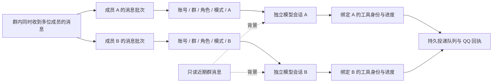

# 群聊成员并行对话与工具执行流

实现日期：2026-10-22。

## 行为

群聊内不同成员短时间同时 @ 同一角色时，分别进入独立模型会话并发处理。一位成员的搜索、下载、工具等待或文字审查不会占住其他成员的整条会话。回复可以按实际完成顺序发出。

执行流标识包含机器人账号、群号、角色、对话模式和真实发送者。例如：

```text
agent:<群角色 agent>:onebot:group:<群号>:role:<角色>:mode:normal:account:default:sender:<成员 A>
agent:<群角色 agent>:onebot:group:<群号>:role:<角色>:mode:normal:account:default:sender:<成员 B>
```

同一成员在同一群、同一角色和模式下复用稳定会话，保留连续追问；该成员的消息依次执行。不同成员的工作区使用同一份经过审核的群角色设定，但可变的对话上下文、摘要、可信工具身份、审批、取消、进度监听和原生模型执行通道分开。



## 隔离规则

- 身份来自 OneBot 入站事件。模型不能通过参数选择其他成员、提升权限或指定另一个执行流。
- 工具保护仍要求唯一且匹配的可信发送者。没有将多个上下文取第一个，也没有放宽身份校验。
- 每个执行流另有可释放的执行锁，覆盖工具绑定到最终投递的整个生命周期。普通入站与恢复入口即使同时到达同一流，也不会重复绑定身份。
- 不同成员的锁互不等待。某条流结束、失败或释放，只清理本流的身份和进度，不会释放另一位成员的绑定。
- 近期群消息继续作为只读背景提供，不会把其他成员的话自动当作当前用户的工具指令。旧版公共群会话历史保留；新消息使用成员会话，不复制旧公共会话里的工具状态或其他人的资源句柄。
- XHS 已有 owner 映射、完整图集规则、预算、权限复检、幂等和回执要求继续适用。下载/产物不能跨成员取用。

并行不意味着取消共享资源限制。当前 OpenClaw 全局模型并发配置为 12；主调用和辅助调用仍受该上限约束。XHS 单登录账号的前台 API FIFO、账号锁、后台下载数量限制，以及同一 QQ 目标的短暂投递顺序均保留。限制作用于相应资源，不再因为多人共用模型 sessionKey 而将整条任务串行化或误报身份歧义。

## 管理控制与恢复

`/new`、`/fresh` 仍按原权限管理本群选定角色当前模式的会话，覆盖该范围全部成员流。执行时只枚举 session key，不读取成员的对话正文；包括正在预处理/等待/执行的流和持久化会话。停止旧流后再重置/删除已有会话。不存在的旧公共会话不被当作必须删除的对象。

切换角色的群模式时，原模式下的成员流会失效和停止；其他群和其他模式的会话数据不会被枚举重置。群管理操作会使本群已缓冲的旧消息失效，后续新消息按新模式进入。

XHS 短信恢复仍以原始发送者、群、账号和入站请求为依据，重新检查授权后使用同一个成员流。该流繁忙时只等待该流，不阻塞其他成员。

## 代码入口

- `src/src/workspaces/routes.js`：在群角色/模式隔离路由上增加账号、发送者标识；校验 ID，生成稳定成员会话。
- `src/src/workspaces/group-streams.js`：每流执行锁；群管理操作所需的 session key 枚举。
- `src/src/gateway.js`：普通消息、角色仲裁背景、角色续聊均使用正确的成员流；绑定身份前获取本流锁，最终释放；群重置和模式切换覆盖对应成员会话。
- `src/src/feature-tools.js`：继续沿用严格身份保护。

## 验证

自动化测试覆盖：

1. 用户、账号、群、角色及模式之间会话隔离；同一成员连续请求的路由稳定；伪造 ID 被拒绝。
2. A 长时间持有执行流时 B 可立即进入；A 的下一次执行等待前一次释放；锁重复释放安全并清理空闲条目。
3. admin 与普通成员同时绑定时各自工具放行，冒用另一位身份被拒绝；进度及迟到工具结果不串流。
4. 群管理枚举仅命中所选账号、群、角色及模式，覆盖已有、活跃和旧公共会话；无旧公共会话时可正常工作。
5. 两位普通成员同时完成真实本地 XHS 服务的列图、后台下载、暂存、持久合并投递（模拟平台回执）；两次投递均归属正确成员；交叉读取产物被拒绝。
6. 原生隔离网关验收：固定挂住成员 A 的模型请求，再同时注入成员 B 的聊天和成员 C 的工具请求。必须观察 B 在 A 释放之前取得模拟 QQ 回复，C 在 A 释放前执行其工具，最后三条流各自取得回复；全过程不得出现身份歧义。

原生验收使用本地假模型和 OneBot 服务，不调用真实小红书、不向真实群聊发测试消息：

```bash
SIMULATION_GROUP_STREAMS=1 \
SIMULATION_FILTER='^parallel-group-participant-streams$' \
node scripts/simulate-conversations.mjs \
  /root/.openclaw/state/simulation-group-streams-20261022-2
```

验收结果：原生网关三人并行测试通过，耗时 58.872 秒。成员 A 被固定挂住模型请求时，B 在入站后 39.897 秒取得模拟 QQ 回复，并触发 A 继续；C 的工具在 A 仍挂起时已执行，C 在 42.903 秒收到回复，A 最后在 58.675 秒收到回复。三条会话唯一，两个工具操作的发送者归属正确。时间来自模拟模型、辅助 CLI 与本地平台，不代表真实上游延迟。

针对性测试 23 项全部通过（包含 4 项新增执行流测试及 XHS 并行完整流程），`npm run check` 和部署脚本的全量回归均通过。首轮原生验收发现模拟器误将运行时追加的内部 user context 当作用户消息；修正为识别实际测试消息后，第二轮通过。这个问题只在测试模型选择逻辑中，不影响生产路由。

原生证据位于 `/root/.openclaw/state/simulation-group-streams-20261022-2/report.json`；两轮隔离网关均已退出。本次未重发历史群请求、未向真实群聊发送验收消息。

生产加载完成：2026-10-22 18:20:12 重启 `openclaw-gateway.service`，18:20:54 默认机器人和月下均重新建立 OneBot WebSocket 连接并报告 Gateway ready。部署的三个运行模块与源码一致；116 个源码产物通过部署检查。
