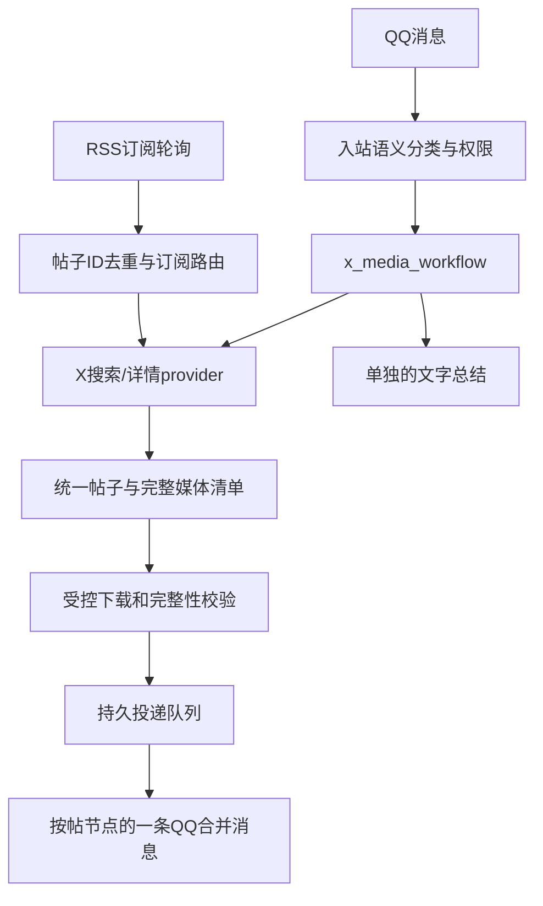

# X/Twitter RSS、搜索与媒体下载接入调研

核查日期：2026-10-23（Asia/Shanghai）。用户要求使用 subagent，已分别委派 RSS 生态、X 搜索下载工具、本地架构三项只读调研；主代理复核关键官方源码。本文是设计建议，没有安装插件、读取或测试 X 登录会话、修改运行配置、重启服务或发送 QQ 消息。

“rss 的 x 搜索下载插件”按 X/Twitter 的 RSS 订阅、即时搜索、图片视频下载理解。若具体指 RSSHub，最接近的是其现有 twitter/user、twitter/keyword 路由；它并不是包含 QQ 交付的完整媒体插件。

## 结论与选型

存在可复用组件，也找到第三方 OpenClaw X 插件，但没有验证到满足本项目所有要求、安装后即可完成搜索→完整媒体下载→QQ 合并消息发送的现成插件。建议将三项能力分开：RSS用于订阅发现；结构化provider用于搜索与详情；宿主批量工作流负责完整媒体、权限与投递。

| 组件 | 已核查能力 | 本项目用途 | 前提/边界 |
| --- | --- | --- | --- |
| DIYgod/RSSHub | Twitter关键词RSS路由、用户及媒体路由；API选择器包含网页会话及开发者API分支 | 需要RSS生态时作为独立订阅源 | 不是免登录服务；取决于实际认证与上游接口。仅源码存在不能证明本机可用 |
| vladkens/twscrape | 异步搜索、用户、帖子详情，结构化结果；网页会话认证 | 非官方API路线的候选搜索/详情provider | README要求已授权账号，推荐auth_token+ct0；默认无可用账号时可能无限等待，必须指定wait_timeout等上限 |
| mikf/gallery-dl | X链接/搜索URL提取、整帖媒体枚举、原图优先及视频处理 | 完整媒体提取适配器；链接下载或必要兼容回退 | 活跃开发已迁到Codeberg；GitHub仅作核查镜像，不据旧release判断最新版本 |
| yt-dlp/yt-dlp | X视频MP4/HLS格式解析、认证和guest分支 | 视频格式处理的可选依赖 | 不能代替静态图集或通用关键词搜索；guest路径不保证任意帖子可访问 |
| xonder/clawbird | 第三方OpenClaw插件，官方X API SDK，搜索、详情及多项读写工具 | 官方API接入参考 | 当前搜索实现仅映射文本/作者/指标/链接，没有请求媒体attachments展开，不能直接作为完整搜图下载插件 |
| RSS-Bridge TwitterBridge | 保留关键词搜索参数及代码 | 不作主选型 | 搜索分支明确注释因Twitter变更不能工作 |
| RSS-Bridge TwitterV2Bridge | 官方API v2搜索/用户时间线 | 已有API权限时可选 | 需要开发者Bearer Token；本项目没有必要仅为这点增加PHP服务 |
| 官方X MCP/API | 搜索、帖子和用户查询，MCP有app-only只读和用户OAuth两条认证路线 | 可替换非官方搜索provider | 需要开发者应用/令牌及对应API权限、按量计费；不把远程整套写工具开放给guest |

账号网页接口也可能变化、限流或要求验证，不能以“无需官方API计费”承诺长期稳定。遇账号不可用需明确auth_required/challenge_required/rate_limited，不把它解释为零结果。

建议先支持一个主provider，避免同时请求RSSHub、twscrape、gallery-dl来重复解析同一帖子。账号授权路线首选twscrape（需实际账号验收）；有正式API预算时提供官方API可切换实现。图片已有可信媒体清单时直接用受控下载器，gallery-dl用于独立链接/兼容解析，yt-dlp只在视频必要时调用。RSSHub在需要订阅时加入，不强制放在即时搜索关键路径。

## 本机已有可复用资源

当前 OneBot 工具中未检索到独立X/RSS业务模块。旧项目另有可迁移参考：

- `/root/Komachi-qq-aibot/app/providers/twitter_media.py`：X链接解析、媒体域名限制、大小/时间预算和metadata_client注入，默认syndication/FxTwitter解析路线。
- `/root/Komachi-qq-aibot/app/providers/twitter_timeline.py`：账号解析、公开时间线提取及原帖URL等字段。

这些文件仅证明有本地实现；不代表2026-10-23仍能联网工作。建议迁移边界与测试，替换provider，勿整体搬旧聊天框架。

当前项目可复用：

- `src/src/features/xhs-workflow.js`：模型一次给搜索/选帖计划，宿主执行确定性后半程，保留前次减少LLM往返的收益。
- `features/tools.js`、`access/operations.js`：可信入站身份、schema、工具超时、幂等业务账本。
- `features/xhs.js`：请求归属、完整图集校验、按帖分组、发送去重思路。
- `delivery/queue.js`：持久文件、原生发送意图、回执及不确定结果处理。
- `workspaces/routes.js`、`group-streams.js`：群内不同用户的独立聊天流。
- `features/bilibili-sync.js`、`features/bilibili.js`：按群订阅和自动事件到投递路线的绑定方式。

必须修改的阻塞点：`delivery/queue.js:19` 和`:96` 对forward限定feature=xiaohongshu/action=media，而且拒绝internal/service身份。不能简单新建x_*工具就直接投递，也不能让自动RSS任务冒充普通用户。应增加显式注册的媒体producer与自动订阅grant，入队、实际发送时复查绑定权限。

## 建议接入架构

工具建议：

- `x_search_posts({query, limit, sort, media_type})`
- `x_inspect_posts({ref_ids})`
- `x_get_profile({account})`
- `x_media_workflow({query?, ref_ids?, post_count, media_type, rank})`，query/ref_ids二选一，默认最多3帖，宿主连续执行搜索、核对、下载、合并发送。
- `x_subscriptions({action, account?, query?})`，只修改当前会话允许的订阅路线。

名称在最终实施前检查工具冲突（Clawbird也使用x_*）；不同时注册重复语义工具。

统一Post结构至少包含id、canonical_url、author、text、published_at、metrics、media[]、completeness、observed_at。RSS仅作为discovery_only，不能把RSS中的缩略图当整帖媒体清单。高赞仅按本次可见、已核实候选的指标比较；缺失为unknown，不能冒充全站排名。

QQ交付建议沿用本项目规则：一帖一节点，节点文字为作者/正文节选/来源链接，后接该帖全部图片或视频；多帖在一条合并消息内，LLM总结单独发送。图片视频混合帖按media[]完整清单校验，不能照搬小红书图片帖单一album_total假设。实际QQ原生混合媒体能力须验收。

## 并发、权限与订阅

- 上游账号限速、媒体下载、QQ发送分层。媒体2至4并发可作为起点，下载/上传等待不占用上游锁；不引入整群聊天锁。
- 结果缓存按帖子ID/查询覆盖范围管理，原文件可按哈希去重，但artifact授权和投递去重绑定具体用户/会话/路线。跨群自动订阅分别记录最后投递位置。
- feature建议为x，actions为read/media/subscribe/manage，独立配置身份和群范围。旧XHS已全员开放并不自动授予X权限。
- read/media可按产品决定对已接入用户/群开放；subscribe仅当前群增删；登录、令牌导入、provider/代理/预算、全局扫描与批量补历史由admin私聊管理。发帖、点赞、关注、私信不在本次只读媒体接入范围。
- RSS服务base URL由宿主配置，用户只给账号/关键词。XML禁用外部实体并设置大小/条目上限；正文和标题都是不可信内容。媒体做DNS/IP、重定向、类型、大小、数量和期限约束，不允许用户提供任意可执行配置或命令行。
- 自动订阅投递grant绑定subscriptionId、routeId、accountId、groupId、feature/action；取消订阅或撤权使已排队投递失效。初次订阅建立基线，默认不刷全量历史。

## 实施及验收顺序

1. 已知X帖子URL→详情与完整媒体→当前会话合并发送，先验证下载provider和QQ投递。
2. 结构化搜索、query语义优化、候选选择、高赞样本比较和x_media_workflow，记录入站到合并回执时间；常规少量图片以约60秒为目标，尚无X链路实测值。
3. RSSHub/RSS适配器、按群账号或关键词订阅、基线/去重/路由撤销/故障通知。

验收包含整帖图片、混合媒体、多视频、转发和引用归属、RSS媒体不全、账号过期/挑战/429、两用户并发、撤权与取消、崩溃恢复及不重复发送。不能用RSS可解析替代搜索可用测试，也不能用下载成功替代QQ发送回执。

## 核对来源（官方仓库和文档）

- RSSHub仓库：https://github.com/DIYgod/RSSHub
- RSSHub关键词路由：https://github.com/DIYgod/RSSHub/blob/master/lib/routes/twitter/keyword.ts
- RSSHub provider选择：https://github.com/DIYgod/RSSHub/blob/master/lib/routes/twitter/api/index.ts
- twscrape：https://github.com/vladkens/twscrape ，README：https://github.com/vladkens/twscrape/blob/main/readme.md
- gallery-dl当前开发仓库：https://codeberg.org/mikf/gallery-dl ，迁移说明镜像：https://github.com/mikf/gallery-dl/blob/master/README.rst
- gallery-dl X提取器：https://github.com/mikf/gallery-dl/blob/master/gallery_dl/extractor/twitter.py
- yt-dlp X提取器：https://github.com/yt-dlp/yt-dlp/blob/master/yt_dlp/extractor/twitter.py
- Clawbird：https://github.com/xonder/clawbird ，搜索实现：https://github.com/xonder/clawbird/blob/main/src/tools/search-tweets.ts
- RSS-Bridge旧桥：https://github.com/RSS-Bridge/rss-bridge/blob/master/bridges/TwitterBridge.php
- RSS-Bridge官方API桥：https://github.com/RSS-Bridge/rss-bridge/blob/master/bridges/TwitterV2Bridge.php
- 官方X MCP：https://docs.x.com/tools/mcp
- 官方X API计费：https://docs.x.com/x-api/getting-started/pricing

本报告未断言具体上游最新版本、公开实例可用性或未经实测的成功率。后续实施应锁定版本，并分别验收账号RSS、即时搜索、完整媒体下载和QQ交付。
